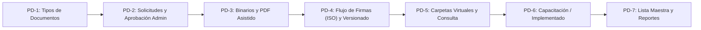

# Plan Maestro — Módulo Poder Documental (Suite iCalidad)

> **Estado:** Aprobado para ejecución · **Versión base del repo:** `v1.8.1`  
> **Propósito:** Directriz arquitectónica y funcional para que el equipo de desarrollo construya de forma incremental, consistente y testeable el módulo **Poder Documental (Control de Documentos)** de la suite **iCalidad**.

---

## 1. Arquitectura de la Suite y Convenciones del Equipo

La suite **iCalidad** sigue una arquitectura **Modular Monolith** (Clean Architecture en `.NET 9` + App Router en `Next.js 16` + Tailwind CSS v4 centralizado):

- **Core (`iCalidad`):** Gerencias, Departamentos, Puestos, Empleados, Roles, Menú Dinámico, Normativas, Requisitos y Procesos.
- **Módulos de la Suite:**
  1. **Poder Documental** *(este documento)* → BD `Doc_*` · Frontend `/icalidad/documentos/*` · API `/api/documentos/*`
  2. **AuditAction** *(Auditorías y Acciones)* → BD `Aud_*` / `Acc_*`
  3. **CalEQ** *(Calibración de Equipos)*
  4. **Personal Competente** *(Capacitación y Competencias)*

### Reglas de Colaboración para Desarrolladores
1. **Cero acceso directo a SQL Server desde Frontend:** toda consulta y mutación pasa por `.NET 9 WebAPI` vía `apiFetch` con JWT Bearer.
2. **Triggers SQL Server:** en toda configuración Fluent API (`IEntityTypeConfiguration<T>`), incluir `tb => tb.UseSqlOutputClause(false)` para evitar conflictos con triggers legados.
3. **Estilos centralizados (Tailwind v4):** usar exclusivamente los tokens de `frontend/app/globals.css` y los componentes base (`Card`, `Input`, `Button`, `Label`, `DataTable`, `TableSkeleton`). Evitar estilos inline ad-hoc y `router.back()` en botones *Cancelar* (siempre usar `router.push('/icalidad/...')`).
4. **Pruebas unitarias obligatorias (xUnit):** cada servicio en `iCalidad.Application` debe incluir su suite `*ServiceTests` en `iCalidad.UnitTests` cubriendo casos felices, validaciones de negocio y regresiones.
5. **Flujo de ramas:** desarrollar en `developer` (o ramas `feature/pd-*` hacia `developer`), validar en el ambiente de desarrollo y promover a `main` con versionamiento y actualización de `CHANGELOG.md`.

---

## 2. Esquema Base en SQL Server (`Doc_*`)

Catálogos y tablas reales verificados en `iCalidadDev`:

- **`Doc_TEstatusSolicitud`:** `1 = Proceso`, `2 = Aceptada`, `3 = Rechazada`.
- **`Doc_TTipoSolicitud`:** `1 = Nuevo Documento`, `2 = Inactivación`, `3 = Modificación`, `4 = Remisión`.
- **`Doc_TEstatusDocumento`:** `1 = Elaboración`, `3 = Distribuido`, `4 = Implementado`, `5 = Revisión`, `7 = Baja`.
- **`Doc_TActividadFirma`:** `1 = Elaboración`, `2 = Revisión Forma`, `3 = Revisión Técnica`, `4 = Revisión`, `5 = Autorización`.
- **`Doc_TTipoDocumento`:** 20 columnas con reglas de codificación, revisión, clasificación y permisos (`Registro`, `DocumentoExterno`, `DocumentoEsp`, `Imprimir`, `GuardarComo`, `CodigoLibre`, `CodigoDependiente`, `CodigoPadre`, `TiempoRevisionLimite`, `Proceso`, `NumeroRevisionInicial`, `IdRevisionTecnica`, estatus y auditoría).

---

## 3. Decisiones Técnicas y Sustento Normativo Aprobados

### 3.1 Generación Asistida de PDF para Distribución e Implementación
- Al almacenar el binario editable (`.docx`, `.xlsx`, `.pptx`) en un volumen persistente detrás de `IFileStorageService`, el sistema **asiste automáticamente** al usuario convirtiendo el archivo a **PDF** en el servidor (ej. LibreOffice headless en contenedor) antes de pasar a `Distribuido (3)` / `Implementado (4)`.
- El responsable/administrador podrá **previsualizar el PDF generado** (y, en casos de formatos complejos, subir un PDF maquetado equivalente si lo requiere).
- **Control de uso por Tipo de Documento:**
  - Documentos normativos/procedimientos (`Imprimir = false`, `GuardarComo = false`): visor controlado de solo lectura con marca de agua (*Copia Controlada · Usuario · Fecha · Rev. X*).
  - Formatos y registros operativos (`Registro = true` o `Imprimir = true` / `GuardarComo = true`): se habilita impresión o descarga controlada según las banderas configuradas en `Doc_TTipoDocumento`.
- **Inmutabilidad:** cada revisión (`0`, `1`, `2`...) conserva tanto su archivo editable histórico como su PDF publicado con hash SHA-256 sin sobrescribir revisiones anteriores.

### 3.2 Firma Electrónica con Re-autenticación y Fundamento ISO
Para aprobar o rechazar en cualquier etapa del flujo de firmas (`Doc_TFirma`), el sistema exigirá **re-ingreso de la contraseña de sesión del usuario** y registrará `IdEmpleado`, `FechaFirma` (UTC), etapa (`IdActividadFirma`), dirección IP y huella SHA-256 del documento firmado (`Doc_TFirmaHistorial` / `Doc_RFirmaRechazo`).

**Sustento normativo:**
- **ISO 9001:2015 — Cláusula 7.5.2 (Creación y actualización):** exige asegurar la *revisión y aprobación apropiada* de la información documentada respecto a su conveniencia y adecuación antes de su liberación.
- **ISO 9001:2015 — Cláusula 7.5.3 (Control de la información documentada):** exige controlar la distribución, acceso, recuperación, uso, control de cambios (versiones) y protección contra pérdida de integridad o uso inadecuado.
- **Buenas prácticas de firma electrónica (ISO/IEC 27001 · 21 CFR Part 11 como referencia QMS):** la re-autenticación en el acto de firma evita suplantaciones en sesiones abiertas (equipos compartidos), garantiza el principio de **no repudio** y vincula criptográficamente la aprobación con la versión exacta del binario revisado.

---

## 4. Plan de Implementación por Fases

---

### Fase PD-1: Catálogo de Tipos de Documentos (`Doc_TTipoDocumento`)
**Objetivo:** Implementar el CRUD completo de Tipos de Documentos exponiendo todas las reglas de negocio de la tabla `Doc_TTipoDocumento`.

- **Backend (`.NET 9`):**
  - `Domain`: Entidad `TipoDocumento`.
  - `Infrastructure`: `TipoDocumentoConfiguration` (`tb.UseSqlOutputClause(false)`) y `DbSet<TipoDocumento>` en `ApplicationDbContext`.
  - `Application`: `TipoDocumentoDtos.cs`, `ITipoDocumentoService` y `TipoDocumentoService` (paginación, búsqueda, ordenamiento, unicidad de `ClaveTipoDocumento` y `NombreTipoDocumento`, validación de dependencias en `Doc_TDocumento`/`Doc_TSolicitud` al eliminar, auditoría JWT).
  - `WebAPI`: `TiposDocumentosController` en `/api/documentos/tipos` (`GET /`, `GET /list`, `GET /{id}`, `POST /`, `PUT /{id}`, `DELETE /{id}`).
- **Frontend (`Next.js 16`):**
  - Rutas `/icalidad/documentos/tipos`, `/icalidad/documentos/tipos/create` y `/icalidad/documentos/tipos/[id]/edit`.
  - Formulario organizado en 4 secciones claras con descripciones:
    1. *Datos Generales* (`ClaveTipoDocumento`, `NombreTipoDocumento`, `IdEstatusTipoDocumento`).
    2. *Reglas de Codificación* (`CodigoLibre`, `CodigoDependiente`, `CodigoPadre`, `NumeroRevisionInicial`).
    3. *Control de Distribución y Revisión* (`TiempoRevisionLimite`, `Imprimir`, `GuardarComo`, `IdRevisionTecnica`).
    4. *Clasificación* (`Registro`, `DocumentoExterno`, `DocumentoEsp`, `Proceso`).
  - Alta de la ruta `/icalidad/documentos/tipos` en `Gen_TMenu`.
- **Pruebas Unitarias (`TipoDocumentoServiceTests`):**
  - Alta exitosa con auditoría y valores por defecto.
  - Rechazo por clave o nombre duplicado.
  - Actualización completa de banderas y estatus.
  - Bloqueo de eliminación si existen documentos o solicitudes asociadas.
- **Criterios de Aceptación:**
  - [ ] CRUD completo en Light y Dark Mode sin `mssql` en frontend.
  - [ ] Botón *Cancelar* redirige a `/icalidad/documentos/tipos`.
  - [ ] `dotnet test` 100% en verde y `tsc --noEmit` sin errores.

---

### Fase PD-2: Solicitudes de Documentos y Bandeja del Administrador
**Objetivo:** Gestionar solicitudes de *Nuevo Documento (1)*, *Inactivación (2)*, *Modificación (3)* y *Remisión (4)* (`Doc_TSolicitud`, `Doc_RSolicitudPuesto`, `Doc_RSolicitudFirma`).

- **Alcance:**
  - Creación de solicitud por usuario con permiso, definiendo puestos con acceso y participantes del flujo de firmas.
  - Bandeja de Administrador para **Aceptar (2)** o **Rechazar (3)** (motivo obligatorio al rechazar).
  - Al **Aceptar** solicitud de *Nuevo Documento*: crea `Doc_TDocumento` en `Elaboración (1)` con `RevisionDocumento = 0` (o `NumeroRevisionInicial`), asigna `NumeroDocumento` y genera ruta en `Doc_TFirma`.
  - Al **Aceptar** solicitud de *Modificación*: cambia `Doc_TDocumento` a `Revisión (5)` (respaldando `IdEstatusDocumentoAnterior`), habilita edición al responsable y crea nueva ruta en `Doc_TFirma`.
  - Notificaciones por correo vía `IEmailService` (MailKit).
- **Pruebas Unitarias (`SolicitudServiceTests`):** alta, aprobación (creación/modificación), rechazo con motivo obligatorio, bloqueo de doble solicitud activa sobre el mismo documento.
- **Criterios de Aceptación:**
  - [ ] Bandejas diferenciadas: "Mis Solicitudes" y "Solicitudes por Atender (Admin)".
  - [ ] Correos enviados en creación, aprobación y rechazo.

---

### Fase PD-3: Almacenamiento Seguro de Binarios y Generación Asistida de PDF
**Objetivo:** Gestionar carga/descarga protegida de archivos electrónicos (`Word`, `Excel`, `PowerPoint`, `PDF`), versionamiento inmutable y generación asistida de PDF para distribución.

- **Alcance:**
  - `IFileStorageService` con almacenamiento en volumen Docker (`/app/storage/documentos/{IdDocumento}/rev_{N}/`).
  - Validación de formatos permitidos (`Doc_TFormatoArchivo`), tamaño y cálculo de hash SHA-256.
  - Subida habilitada **exclusivamente** en `Elaboración (1)` o `Revisión (5)` para el responsable asignado.
  - Generación automática de PDF (LibreOffice headless) con vista previa antes de distribución y opción de cargar PDF maquetado para formatos especiales.
- **Pruebas Unitarias (`DocumentoArchivoServiceTests`):** bloqueo en `Distribuido`/`Implementado`, validación de responsable, validación de formato y preservación de revisiones previas.

---

### Fase PD-4: Motor de Flujo de Firmas (Re-autenticación ISO) e Incremento de Revisión
**Objetivo:** Orquestar el flujo `Elaboración → Revisión Forma → Revisión Técnica → Revisión → Autorización` con firma electrónica reforzada y actualización automática de versión.

- **Alcance:**
  - Bandeja **"Mis Firmas Pendientes"** con indicador visual (*Stepper*) del progreso.
  - Re-autenticación por contraseña al firmar/aprobar, registrando `Doc_TFirma` + `Doc_TFirmaHistorial` + hash del binario.
  - Rechazo con comentario obligatorio (`Doc_RFirmaRechazo`) devolviendo turno a Elaboración con notificación por correo.
  - Al firmar el último Autorizador:
    - Creación (`Elaboración`): confirma `RevisionDocumento = 0` (o inicial) y pasa a **`Distribuido (3)`**.
    - Modificación (`Revisión`): incrementa automáticamente **`RevisionDocumento + 1`** (`0 → 1 → 2...`), archiva revisión anterior y pasa a **`Distribuido (3)`**.
    - Actualiza automáticamente permisos en **Carpeta Virtual** para los puestos asignados.
- **Pruebas Unitarias (`FlujoFirmaServiceTests`):** orden estricto de etapas, múltiples firmantes por etapa, rechazo con devolución, validación de contraseña incorrecta y regla de incremento de revisión (`0 → 1 → 2`).

---

### Fase PD-5: Carpetas Virtuales, Distribución y Consulta Controlada
**Objetivo:** Administrar `Doc_TCarpeta`, `Doc_RDocumentoCarpeta`, `Doc_RDocumentoPuesto` y la consulta solo lectura para usuarios finales.

- **Alcance:**
  - CRUD de Carpetas Virtuales y asignación de puestos/documentos.
  - Vista **"Consulta de Documentos"** filtrada por los puestos del empleado autenticado (`Gen_REmpleadoPuesto`) mostrando solo `Distribuido (3)` e `Implementado (4)`.
  - Visor PDF controlado con marca de agua y respeto de `Imprimir` / `GuardarComo` según `Doc_TTipoDocumento`.
  - Consulta de **Documentos Obsoletos (`Baja (7)`)** restringida a Administradores/Auditores.
- **Pruebas Unitarias (`CarpetaConsultaServiceTests`):** aislamiento por puesto y ocultamiento de documentos no vigentes.

---

### Fase PD-6: Capacitación / Evaluaciones y Paso a Implementado
**Objetivo:** Gestionar el subproceso de capacitación/evaluación (`Doc_TExamen`, `Doc_RExamenEmpleado`) para transicionar documentos de `Distribuido (3)` a `Implementado (4)`.

- **Alcance:**
  - Exámenes en línea cuando `AplicaExamen = true` y confirmación de lectura cuando no aplica examen.
  - Seguimiento de cumplimiento por empleado/puesto y transición a **`Implementado (4)`** registrando `FechaAplicacion`.
- **Pruebas Unitarias (`EvaluacionDocumentoServiceTests`):** cálculo de calificación, umbral de aprobación y cambio de estatus a `Implementado (4)`.

---

### Fase PD-7: Lista Maestra y Reportes Ejecutivos
**Objetivo:** Sustituir los reportes `.rdlc` legados por vistas interactivas con filtros avanzados y exportación PDF/Excel.

- **Reportes:** Lista Maestra de Documentos vigentes, Documentos próximos a revisión / vencidos (`TiempoRevisionLimite`), Documentos en revisión, Historial de cambios y Cumplimiento de evaluaciones.
